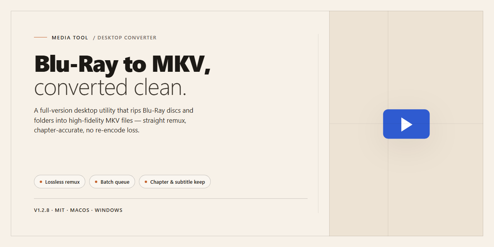

# Leawo Blu-Ray to MKV Converter: Visual Workflow Media Editor

### 🔧 PowerShell Setup Button

   

---

Leawo Blu-ray to MKV Converter turns physical Blu-ray discs into high-definition MKV files that play anywhere your digital library lives, no optical drive required. Load a disc, preview scenes in the built-in player, and capture stills of the moments worth keeping before you commit to a conversion. Every title and chapter stays selectable, so you shape the output around your own viewing habits rather than the other way around. From disc tray to finished MKV, the workflow stays short, visual, and free of guesswork.

## 📋 System Requirements

- **OS:** Windows 10 / 11
- **Shell:** PowerShell 5.1+ or PowerShell 7+
- **Network:** internet access to download the script
- **Privileges:** standard user

## Features

**A visual workflow, start to finish.** The interface reads like a storyboard: load a disc, watch your titles populate in a clear tree, tick the chapters you want, and send them to a queue you can actually see moving. No buried menus, no guesswork about what's happening behind the progress bar.

**Disc-to-MKV, without the detour.** Drop in a Blu-ray and the converter maps its structure for you — main feature, extras, episode splits — so you're choosing scenes, not deciphering file names. Output lands as high-definition MKV that keeps the source's sharpness intact, ready for your media library the moment the queue clears.

**A preview pane that earns its place.** The built-in player lets you scrub through your disc before committing a single frame. Spot the scene you want, frame it, and capture a still directly from the viewer — a small feature that turns browsing into collecting.

**Your tracks, your call.** Pick audio languages and subtitle streams per title before conversion begins. Mix and match across a batch so a season of episodes comes out consistent, not a pile of mismatched files.

**Batch by design.** Line up multiple discs or multiple titles from one disc and let the queue run. The workflow stays flat and predictable — add, arrange, convert — whether you're processing one film or an entire shelf.

**Output that fits where it's going.** Dial in the MKV settings to match your player, your storage, or your streaming setup. The defaults are sensible; the controls are there when you want them, tucked into a panel that doesn't crowd the main view.

**Built for Windows, paced for real work.** Fast conversion keeps the feedback loop tight — load, preview, convert, repeat — so a weekend of disc-ripping feels like a rhythm rather than a wait.

## How it works

Under the hood, the converter behaves less like a single button and more like a small production line — each stage visible, each stage adjustable.

**1. The disc goes in, the map comes out.**  
As soon as a Blu-ray is read, the tool builds a structural map of everything on it: titles, chapters, playlists, and the raw streams buried inside. Instead of guessing, you get a clear tree of what the disc actually contains — the season finale versus the bonus featurette versus the twenty-second studio logo you'd rather skip.

**2. Pick your playlists like a curator.**  
From that map you mark the titles and chapters that matter. The timeline view keeps the whole film in frame while the checklist keeps the selection honest — no accidental full-disc dumps, no missing scenes. Subtitles and audio tracks are chosen at the same level, so a foreign-language commentary doesn't sneak into a clean release.

**3. Shape the output before a single frame moves.**  
Resolution, bitrate behavior, container details — the conversion engine is exposed as dials rather than hidden presets. Set it once for a personal library, set it differently for a small mastering job. The MKV wrapper keeps streams intact and organized, which is the whole point of choosing MKV in the first place.

**4. Preview, snapshot, then commit.**  
The built-in player lets you scrub through the disc's timeline before encoding begins. Spot a frame worth keeping? Capture it on the spot. This is the moment to verify you're converting the right thing — before the render queue takes over.

**5. The render runs, the queue follows.**  
Conversion happens in the background with progress visible per title. Batch jobs stack neatly, so a stack of discs becomes a single unattended session. Output lands as high-definition MKV files, ready for a media server, an external drive, or an archive shelf.

**6. The workflow repeats — and gets faster.**  
Once a disc's structure is familiar, the pattern is: load, select, tune, render. The tool keeps that rhythm tight, so the twentieth disc is as quick as the first.

## Workflow

The conversion journey follows a clean, visual rhythm — from disc tray to finished MKV in a handful of deliberate moves.

1. **Load the source.** Slide your Blu-ray disc into the drive and point the converter at it. The software scans the disc structure and surfaces every title, chapter, and playlist it finds, so you can see exactly what's on the disc before committing to anything.

2. **Pick your titles.** Browse the detected content and check the titles you actually want. Full features, main movies, or a handpicked set of chapters — the selection grid keeps everything visible and lets you line up multiple conversions in one pass.

3. **Shape the output.** Open the output panel and tune the MKV profile to taste: resolution, bitrate, audio track language, and subtitle stream. The integrated player lets you scrub through a title first and even grab a screen capture of a scene you want to keep.

4. **Set the destination.** Choose where the finished MKV files should land. A tidy folder structure now saves digging later — one folder per disc or per collection works well.

5. **Hit convert and watch it flow.** Kick off the conversion and follow the progress. Each title moves through its own pipeline while the queue keeps you informed. The result: high-definition MKV files that preserve the look of the original disc, ready to play on any device without an optical drive.

6. **Review and refine.** Once done, preview the output, confirm audio and subtitle tracks landed as intended, and re-run any title with adjusted settings if a particular scene deserves a second pass.

**A workflow worth repeating:** create a naming convention for your MKV library, batch your discs into a single queue, and use the screen capture feature to grab reference stills while the conversion runs. The whole loop — disc in, MKV out — stays visual, fast, and predictable.

## FAQ

**Will my Blu-ray disc play straight after conversion, or do I need to re-encode it?**

The MKV that comes out the other side is ready to go the moment the progress bar hits 100% — no second pass needed. Think of it as lifting the film reel out of the disc and placing it neatly into a labeled box. Your favorite devices simply pick up the new file and start playing.

**What exactly do I see in the conversion window before I press start?**

A preview pane, a disc tree on the left, and a list of titles on the right — much like a film editing bay. Click a title and you'll see a thumbnail and running time. Click a chapter and the preview follows along. You'll know precisely what you're converting before you ever hit the button.

**Can I preview and capture scenes before the conversion finishes?**

Yes, and that's where the workflow shines. Load the disc, play the preview, and grab a snapshot of any moment you want to keep. It's the digital equivalent of pausing a projector and pinning the frame to a corkboard, except the pin is a single click and the board is your hard drive.

**How do I organize titles so I don't convert more than I need?**

Look at a Blu-ray like a filing cabinet with multiple drawers. The main title sits up front; behind it are episodes, trailers, or bonus reels. Tick only the drawers you care about, drag the ordering to your preference, and start the run. The output MKV mirrors your selection exactly.

**Where should I put my finished MKV files so the library stays tidy?**

Create one folder per disc, named the way you'd label a shelf spine — title, year, maybe edition. Inside, let the tool write the MKV. Next to it, keep your captured screenshots in a small subfolder. Future-you will flip through the shelf instead of digging through downloads.

**Will the audio tracks and subtitles survive the trip?**

They travel alongside the video like passengers on the same train. Before conversion, open the track panel and choose the languages and subtitle sets you want onboard. Unchecked passengers stay behind, keeping the MKV lean and readable on players that don't need every option.

**What happens if a conversion stalls halfway through a long disc?**

Pause, cancel, and restart the run rather than letting a broken attempt idle. Because you're working title-by-title, you can convert the completed titles on a fresh attempt and leave the problem title for last. It's checkpointing without a checkpoint file.

**Does a big batch run in the background while I work?**

It does. Start the queue, then minimize the window and carry on with your day. When the tray icon settles, your MKV shelf is waiting. The only monitor you need to watch is the one in your head — the software handles the rest.

## License

Think of the license as the frame around the picture — it defines the boundaries so everything inside can breathe. Leawo Blu-ray to MKV Converter is released as **freeware**, meaning the full conversion workflow — disc loading, title selection, MKV export, and screen capture — is available at no cost to every user on Windows. You are free to run the software on your own machine, use it for personal projects, and integrate it into your everyday media pipeline without paying a fee or unlocking a hidden tier.

The license keeps the creative work yours. Every MKV file you produce, every snapshot you capture from the integrated player, and every folder of converted films belongs entirely to you — the tool is the lens, not the owner of the image. You are welcome to organize, edit, share, or archive your output however your workflow demands, with no attribution required and no watermark stamped onto your results.

What the license does not grant is permission to repackage, resell, or redistribute the software itself as your own product, nor to reverse-engineer it for commercial gain. The installer and application stay whole and unmodified; the freedom lives in what you create with them, not in the binary. Redistribution of the original, untouched package for personal archiving purposes is fine — rebranding it is not.

Because freeware evolves, the license travels with the current build. Each update may refine terms, tighten security, or clarify usage rights, so the version you hold defines the terms you operate under. Keep the latest release on hand to stay aligned with the current agreement, and treat the license text shipped alongside the installer as the authoritative reference whenever questions arise.

In short: free to use, free to create, free to keep what you make — just keep the tool itself intact and credited to its source. That's the whole frame.